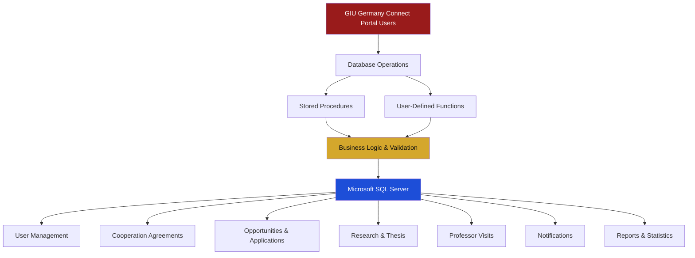
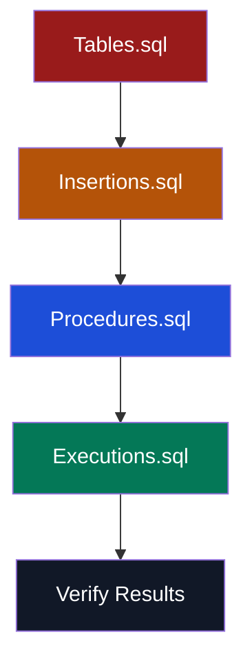

# 🇩🇪 GIU Germany Connect
### Academic Opportunities & Cooperation Portal

<div align="center">


<a href="https://git.io/typing-svg">

</a>

<br/>


<br/><br/>

**A centralized academic cooperation platform connecting GIU with universities, professors, researchers, and industry partners worldwide.**

[Overview](#-overview) • [Features](#-core-modules) • [Architecture](#-system-architecture) • [Installation](#-getting-started) • [Team](#-team)

</div>

---

## 📑 Table of Contents

<details open>
<summary><b>Explore the project documentation</b></summary>

- [Overview](#-overview)
- [Project Vision](#-project-vision)
- [Core Modules](#-core-modules)
- [System Architecture](#-system-architecture)
- [Database Structure](#-database-structure)
- [Project Structure](#-project-structure)
- [Getting Started](#-getting-started)
- [Implementation Standards](#-implementation-standards)
- [Team](#-team)
- [Technologies](#-technologies)
- [Future Improvements](#-future-improvements)

</details>

---

## 🌍 Overview

**GIU Germany Connect** is a database-driven academic cooperation portal designed to manage and streamline the relationships between the German International University (GIU), partner universities, academic staff, students, and industry representatives.

The system provides a centralized environment for managing international academic cooperation, research activities, student opportunities, applications, agreements, and professor visits.

### 🎯 Project Vision

To build a structured and reliable database system that simplifies academic collaboration and supports international educational opportunities through organized data management and automated database operations.

### 👥 System Users

| User Role | Main Responsibility |
|:---|:---|
| 🛡️ System Admin | Manage users and system operations |
| 🤝 Cooperation Coordinator | Manage international agreements |
| 🎓 Program Coordinator | Manage academic opportunities |
| 👨‍🏫 GIU Academic | Participate in research and academic activities |
| 🌐 Partner Professor | Collaborate with GIU academics |
| 🏢 Company Representative | Provide industry-related opportunities |
| 💡 Topic Provider | Submit thesis and research topics |
| 🎒 Student | Explore and apply for opportunities |
| 🔔 Portal User | Receive system notifications |

---

## 🚀 Core Modules

The database is organized into seven major functional modules.

<details open>
<summary><b>01 — User Management</b></summary>

👤 Centralized user and account management.

- Add and edit students, professors, and company representatives.
- Manage user information and account status.
- Activate or deactivate accounts.
- Maintain structured user records.

</details>

<details>
<summary><b>02 — Cooperation Agreements</b></summary>

🤝 Manage international cooperation between GIU and partner institutions.

- Mobility Agreements.
- Research Agreements.
- General Memorandums of Understanding (MoUs).
- Track agreement information and partner relationships.

</details>

<details>
<summary><b>03 — Opportunities & Applications</b></summary>

🎓 Organize academic opportunities and student applications.

- Exchange programs.
- Workshops and short-term programs.
- Thesis opportunities.
- Application submission and management.
- Accept or reject applications.

</details>

<details>
<summary><b>04 — Research & Thesis</b></summary>

🔬 Support research collaboration and thesis management.

- Thesis topics and supervisors.
- Research areas.
- Research projects.
- Research outputs.

</details>

<details>
<summary><b>05 — Professor Visits</b></summary>

✈️ Organize academic visits and collaboration activities.

- Professor visit schedules.
- Visit activities.
- Visit reports.
- Outcomes and follow-up records.

</details>

<details>
<summary><b>06 — Reports & Dashboards</b></summary>

📊 Provide data-driven insights into academic cooperation.

- User statistics.
- Opportunity statistics.
- Agreement statistics.
- Partner statistics.
- Available and occupied seats.

</details>

<details>
<summary><b>07 — Notifications</b></summary>

🔔 Keep portal users informed.

- Create and send notifications.
- Associate notifications with portal users.
- Track read and unread status.

</details>

---

## 🏗️ System Architecture

The project follows a database-centered architecture in which SQL Server manages the system's data, relationships, business rules, and database operations.



---

## 🗄️ Database Structure

The database is implemented using **Microsoft SQL Server** and uses relational database concepts to maintain data integrity and consistency.

### Database Design Principles

| Concept | Purpose |
|:---|:---|
| Primary Keys (PK) | Uniquely identify records |
| Foreign Keys (FK) | Maintain relationships between entities |
| UNIQUE Constraints | Prevent duplicate values |
| CHECK Constraints | Validate permitted values |
| NOT NULL Constraints | Ensure required information exists |
| Stored Procedures | Encapsulate database operations |
| User-Defined Functions | Implement reusable database logic |

### Database Workflow



---

## 📁 Project Structure

```text
GIU-Germany-Connect/
│
├── 📄 Tables.sql
│   └── Database schema, tables, constraints and relationships
│
├── 📄 Insertions.sql
│   └── Sample data for all tables
│
├── 📄 Procedures.sql
│   └── Stored Procedures and User-Defined Functions
│
├── 📄 Executions.sql
│   └── Execution examples and testing scenarios
│
├── 📄 Team_Information.pdf
│   └── Team members and project information
│
└── 📄 README.md
    └── Project documentation
```

---

## ⚙️ Getting Started

Follow these instructions to set up and execute the project locally.

### Prerequisites

Before running the project, make sure you have:

- Microsoft SQL Server.
- SQL Server Management Studio (SSMS).
- Basic knowledge of SQL Server and T-SQL.

### Installation

**Step 1 — Clone the repository**

```bash
git clone https://github.com/USERNAME/GIU-Germany-Connect.git
```

**Step 2 — Open SQL Server Management Studio**

Launch SSMS and connect to your SQL Server instance.

**Step 3 — Create the database**

Create a new database named:

```sql
GIU_Germany_Connect
```

**Step 4 — Execute SQL scripts**

Run the following files in the exact order:

| Order | File | Description |
|:---:|:---|:---|
| 1 | `Tables.sql` | Create database tables and relationships |
| 2 | `Insertions.sql` | Insert sample records |
| 3 | `Procedures.sql` | Create procedures and functions |
| 4 | `Executions.sql` | Execute and test database operations |

**Step 5 — Verify the results**

Execute the examples in `Executions.sql` and inspect the returned results to verify the database operations.

> ⚠️ **Important:** Run the scripts on a fresh database. Re-executing insertion scripts may cause duplicate-key errors unless the database is reset first.

---

## 🛡️ Implementation Standards

The project follows specific database development standards:

- **Exact Naming:** Procedure and function names and signatures must match the provided User Stories.
- **Error Handling:** Return clear and meaningful error messages instead of exposing raw SQL errors.
- **Input Validation:** Validate invalid inputs and non-existent IDs.
- **Data Integrity:** Use appropriate constraints to protect database consistency.
- **Duplicate Prevention:** Handle duplicate records appropriately.
- **User Story Coverage:** Provide an execution example for every implemented User Story.

---

## 👩‍💻 Team

This project was developed collaboratively as part of the GIU Database course — Winter 2026.

| Team Member | Application No. | Tutorial Group | Contributions |
|:---|:---|:---|:---|
| Member 1 | — | — | User Stories — |
| Member 2 | — | — | User Stories — |
| Member 3 | — | — | User Stories — |
| Member 4 | — | — | User Stories — |
| Member 5 | — | — | User Stories — |

📄 For more information, see [`Team_Information.pdf`](Team_Information.pdf).

---

## 🧰 Technologies

<div align="center">


<br/>


</div>

---

## 🔮 Future Improvements

Potential extensions that could enhance the platform:

- 🌐 Web-based user interface.
- 🔐 Role-based access control.
- 📧 Automated email notifications.
- 📊 Advanced analytical dashboards.
- 🔍 Advanced search and filtering.
- 📈 More comprehensive reporting features.

---

<div align="center">


### 🇩🇪 Connecting Academia. Creating Opportunities. Building Partnerships.

**GIU Germany Connect — Database Project | Winter 2026**

<sub>Designed and developed with Microsoft SQL Server & T-SQL.</sub>

<br/>


</div>
